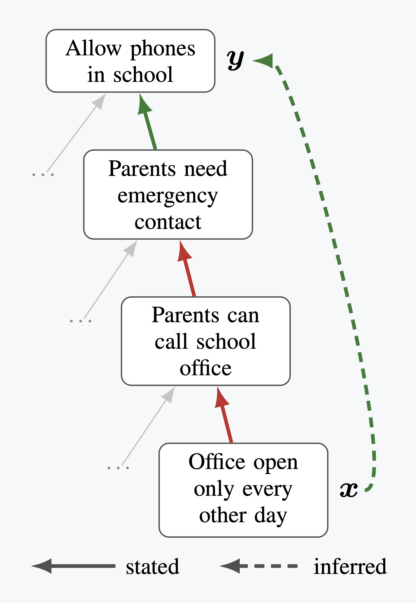
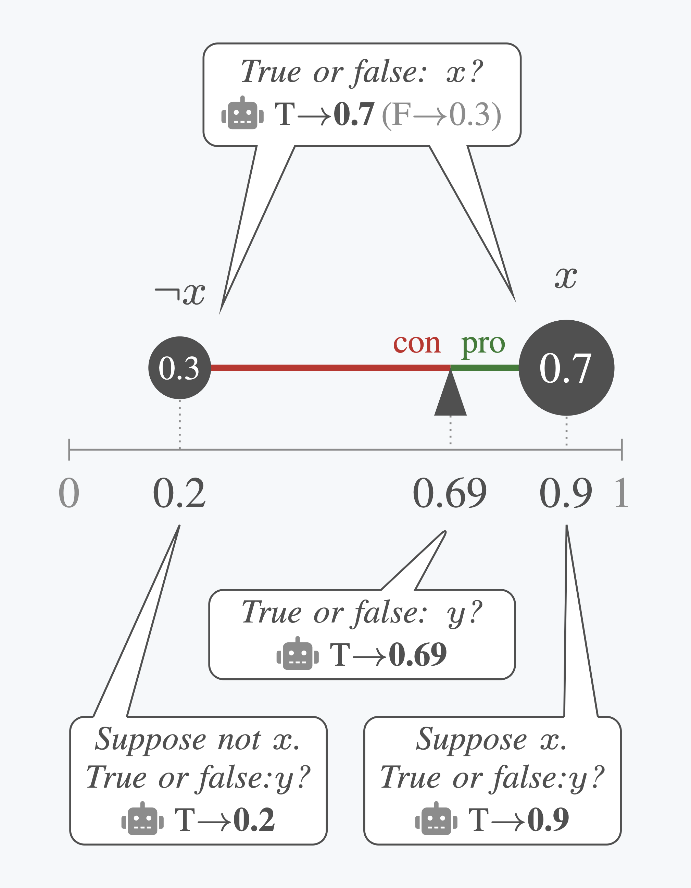
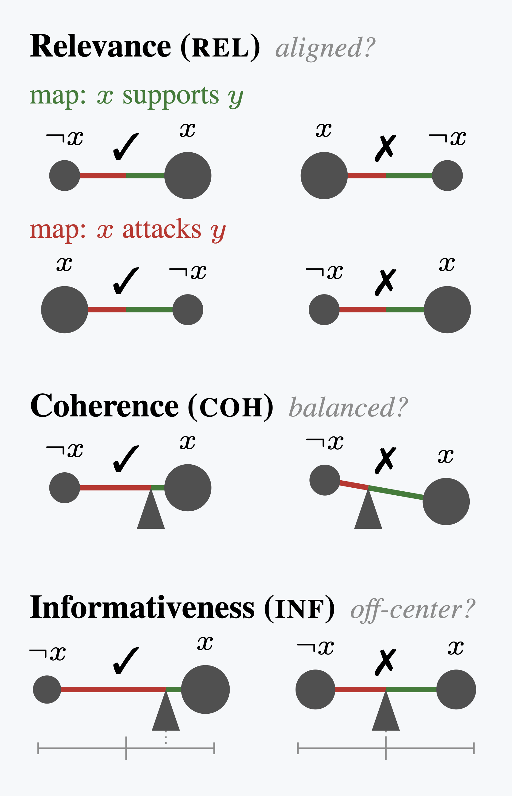
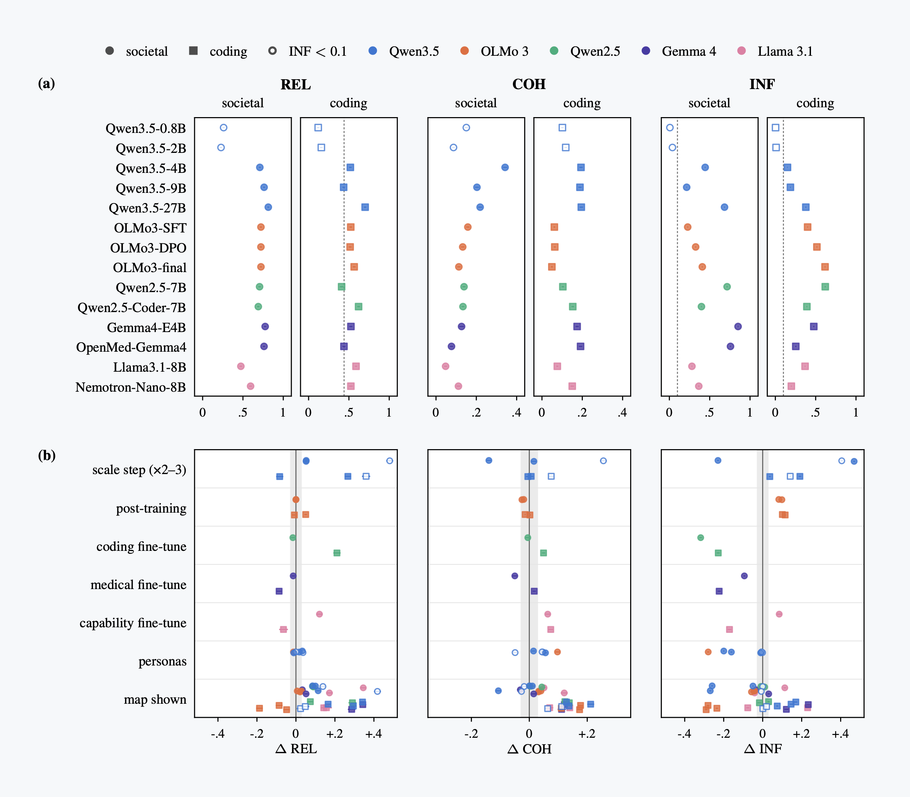

# belcy-eval
[](https://github.com/logikon-ai/belcy-eval/actions/workflows/ruff.yml)
[](https://github.com/logikon-ai/belcy-eval/actions/workflows/pytest.yml)
[](https://doi.org/10.5281/zenodo.23727768)

**Bayesian BELief ConsistencY Evaluation of LLMs.** belcy uses a debate's structure of
reasons as a yardstick, and asks whether a language model's degrees of belief respond to
reasons the way that structure says they should, without ever needing to know who is
right in the debate.

> **Status.** belcy-eval 0.2.0 is the code behind a technical report in preparation:
> *Do Language Model Credences Follow the Argument? A Bayesian Benchmark for Belief
> Consistency (BelCy)*. Until the report is out, the results below are preliminary.

<table>
  <tr>
    <th>① The map<br><sub><i>the yardstick</i></sub></th>
    <th>② The model<br><sub><i>its answers, as a lever</i></sub></th>
    <th>③ The checks<br><sub><i>three scores, side by side</i></sub></th>
  </tr>
  <tr>
    <td></td>
    <td></td>
    <td></td>
  </tr>
</table>

*One pair from one map. ① The map entails that x speaks for y. ② Four separate questions
give the model's credences, drawn as a lever. ③ Each check reads the same lever.*

## How it works

**The map.** An argument map says only which claim speaks for or against which, not who
is right. Chained together, its steps entail whether a claim x should raise or lower the
credence in a claim y; where several paths join them, the direction is computed exactly.
belcy draws its maps from [syncIALO](https://huggingface.co/datasets/DebateLabKIT/syncialo-raw),
a corpus of synthetic debates.

**The questions.** For each pair, the model answers four questions, each in a fresh
conversation: how likely is x, how likely is y supposing x, supposing not-x, and how
likely is y. Each credence is read off the logprobs of "Yes" and "No", never from a
number the model writes out.

**The scores.**

- **Relevance:** does belief move the way the map says? +1 is perfect, 0 is chance.
- **Coherence:** do the four answers satisfy the law of total probability? 0 is chance.
- **Informativeness:** does the model commit to anything, or sit near 50% everywhere?

Each score can be gamed alone, but not all three together, so they are always reported
side by side, never merged. The method and its validation will be set out in the
technical report (see [Citation](#citation)).

## Results



*(a) Relevance (REL), coherence (COH) and informativeness (INF) of 14 open-weight
models, 0.8B to 27B, on 1000 societal and 1000 coding maps, with the map not shown;
95% bootstrap intervals, hollow markers below the informativeness floor; dotted: an
agent that answers from another map's probabilities. (b) Paired differences on the same
maps for each variation; the grey band is the serving noise (±0.03).*

- **Each change moves its own combination of scores.** Scale, post-training,
  fine-tuning, personas and showing the map move different combinations of the three
  scores. A coding fine-tune raises relevance on coding maps by 0.21, against −0.02 on
  societal maps. Showing the map raises coherence on coding maps for every model, and
  relevance on societal maps for 13 of 14.
- **Distinct from capability within one model.** Over the two post-training steps of
  OLMo 3 7B, a capability composite of five standard benchmarks rises, while relevance
  on societal maps stays flat and coherence does not rise. Across model families,
  relevance on societal maps and coherence on coding maps do rise with capability.
- **Easy to game alone, hard to game all together.** Simulated agents with known
  rules show it. An agent that sits on the fence but shifts its conditionals the right
  way is relevant and coherent, and only informativeness exposes it. An agent that is
  sure of everything and perfectly coherent, but shifts at random, is exposed only by
  relevance.

All numbers are computed from the logs on the Hugging Face Hub (see [Data](#data)),
so they can be checked and re-analysed.

## Running it

```sh
uv sync
uv run pytest

# read the prompts before spending GPU time: they are the instrument
# (also prints each pair's entailed sign and Pr(y|x), Pr(y|¬x), and reference profiles)
uv run python -m belcy_eval.scripts.dump_map --corpora synthetic_corpus-001:eval --limit 1

# against any OpenAI-compatible endpoint that serves the model
export VLLM_BASE_URL=... VLLM_API_KEY=...
uv run inspect eval src/belcy_eval/belcy.py --model vllm/<model> -T n_maps=10 --log-dir logs/run-1

# a markdown report of the scores
uv run python -m belcy_eval.scripts.print_evals --log-dir logs/run-1
```

Maps are drawn from a weighted mix of syncIALO corpus splits, set with `-T corpora=...`
as comma-joined `corpus_id:split[:weight]` entries, e.g.
`synthetic_corpus-001:test:0.7,synthetic_corpus-002:eval:0.3`. `n_maps` is divided across
the entries by weight. Splits come from the latest revision of `DebateLabKIT/syncialo-raw`
unless `-T corpus_revision=<sha>` pins a commit; pin it for runs that must draw the same
maps later. `-T show_map=true` renders the whole map in every prompt, and
`-T personas=schwartz` puts a value profile in front of the instruction. The docstring of
`belcy()` in `src/belcy_eval/belcy.py` lists every task parameter.

**What the endpoint must provide.** belcy reads each credence off the logprobs of the
first generated token. The server must therefore return top logprobs, at least 8 per
token (in vLLM, `--max-logprobs` of 8 or more). It must support structured outputs, and it
must honour the temperature belcy sets on every elicitation call. A reasoning parser is
not needed, since belcy never parses model text. Keep the KV cache at the model's own
dtype, because an fp8 cache perturbs the logprobs the credences are read from. Pin the
model to a Hub revision for runs that must stay comparable. Models whose chat template
opens a `<think>` block on every turn, with no switch to turn it off, are out of scope;
models that think only on request are fine.

## Reading the scores

- **Compare models, don't grade them.** The scores are relative; what a map allows
  depends on the map.
- **Read all three together.** A high score on one axis means little without the other two.
- **Informativeness is a trait, not a quality.** It says how opinionated a model is;
  higher is not better.

## Data

The manifests of the report's 2000 maps and the logs of all its runs are on the Hugging
Face Hub at [ggbetz/belcy-eval-logs](https://huggingface.co/datasets/ggbetz/belcy-eval-logs).
To score a new model on the same maps, run with the report's task parameters
(`-T corpora=synthetic_corpus-001:train` or `deepcoder_codeforces-001:train`,
`-T n_maps=1000`, `-T corpus_revision=cdb139be82a4580a0fa1068ab8c1c4afef56e3c6`, the rest
at their defaults), then check that the log drew exactly the listed maps:

```sh
uv run python -m belcy_eval.scripts.export_manifest check \
    --manifest synthetic_corpus-001.ids.txt logs/run-1/<log>.eval
```

## Citation

If you use belcy, please cite the software (see `CITATION.cff`): Gregor Betz,
*belcy-eval: Bayesian belief consistency evaluation of LLMs*, version 0.2.0, 2026,
doi:[10.5281/zenodo.23727768](https://doi.org/10.5281/zenodo.23727768).
The technical report, *Do Language Model Credences Follow the Argument? A Bayesian
Benchmark for Belief Consistency (BelCy)*, is in preparation; please cite it too once
it is out.

## License

Code: MIT (`LICENSE`). The report's manifests and logs: ODC-BY (see the dataset card).
